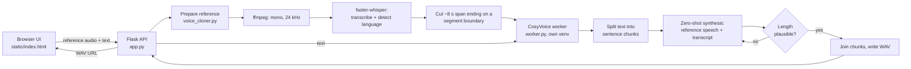

# Voice Cloner

Zero-shot voice cloning in the browser. Upload a short recording of a voice, type English text, and get the text back spoken in that voice.

- **Backend:** Flask, [CosyVoice 3](https://github.com/FunAudioLLM/CosyVoice) for synthesis, [faster-whisper](https://github.com/SYSTRAN/faster-whisper) for the reference transcript
- **Frontend:** plain HTML, CSS and JavaScript (no build step)

---

## How it works



1. **Reference preparation.** The uploaded clip is converted with ffmpeg, transcribed by faster-whisper, and cut to a clean span of about 8 seconds (never more than 12) that ends on a segment boundary.
2. **Voice match mode (default).** CosyVoice receives both the reference speech and its transcript, so the voice and speaking style are carried from the first word. A second mode, *cross-lingual*, uses only a speaker embedding and is available under **Advanced**.
3. **Chunked synthesis.** The text is split into sentence chunks. The sampling in the model is random and sometimes stops early, so each chunk's duration is checked against its text length and the chunk is regenerated if it looks wrong.
4. **Persistent worker.** CosyVoice runs in a separate process and virtual environment (`.venv-cosyvoice`) and stays loaded between requests.


## Requirements
- Python 3.11
- [ffmpeg](https://ffmpeg.org/) on `PATH`
- The CosyVoice repository and the `Fun-CosyVoice3-0.5B` weights in `models/CosyVoice/` (see the CosyVoice project for setup), with its dependencies installed in `.venv-cosyvoice`
- The faster-whisper `medium` model is downloaded into `models/faster-whisper/` on first use

## Setup and run

```powershell
# web server environment
python -m venv .venv
.venv\Scripts\pip install -r requirements.txt

# start the app
.venv\Scripts\python app.py
```

Open Link at (https://kurt-suggestion-empty-submitting.trycloudflare.com/) . The first page load shows "Loading voice model…" until CosyVoice has finished loading, which takes about a minute.

## Project layout

```
app.py             Flask server and API (/api/status, /api/clone)
voice_cloner.py    Reference preparation and worker management
worker.py          Persistent CosyVoice process (runs in .venv-cosyvoice)
static/            index.html, style.css, app.js
assets/            Demo reference audio, generated outputs, and README players
```

## Accent

CosyVoice has no accent setting. The accent and delivery come from the reference recording, so choose a reference whose accent matches what you want.

## Responsible use

Voice cloning can be misused for impersonation. Only clone voices you have permission to use, and only publish recordings you have the right to share.
